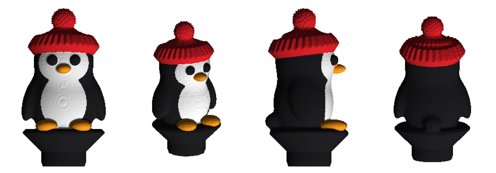

# Пингвин-топпер для кофейного стаканчика

Оригинальная модель: пингвин в красной вязаной шапке с помпоном. Снизу — круглый выступ,
который вставляется в углубление на крышке флип-топ.
Размер: 23 × 22 × 42 мм. Выступ: Ø12 мм, высота 4 мм.

## Файлы
| Файл | Что это |
|---|---|
| `penguin_multicolor.3mf` | всё в одном файле: один объект из 4 частей по цветам |
| `penguin_single_color.stl` | вся фигурка одним телом (один цвет / под покраску) |
| `penguin_black.stl`, `penguin_white.stl`, `penguin_orange.stl`, `penguin_red_hat.stl` | те же части по отдельности |

## Печать
- Выступом на стол, без поддержек (низ площадки — воронка 45°). Пятно контакта маленькое (Ø12 мм),
  поэтому включите кайму (brim) 3–5 мм.
- В 3MF назначьте филамент каждой части: black, white, orange, red_hat.
- Слой 0,12–0,16 мм.

## Подгонка под крышку
Измерьте диаметр и глубину углубления на своей крышке и задайте `PEG_D` (диаметр минус ~0,2 мм)
и `PEG_H` в начале `make_penguin.py`, затем `python3 make_penguin.py`.
